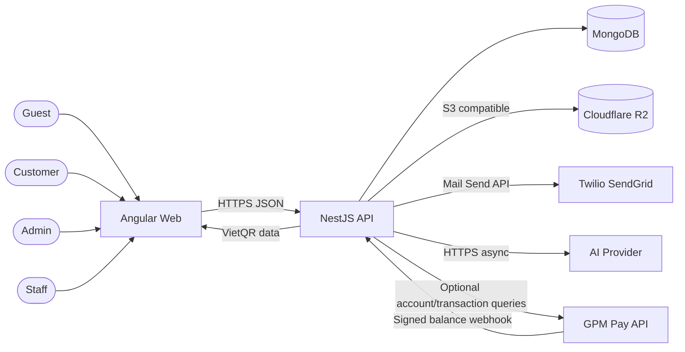
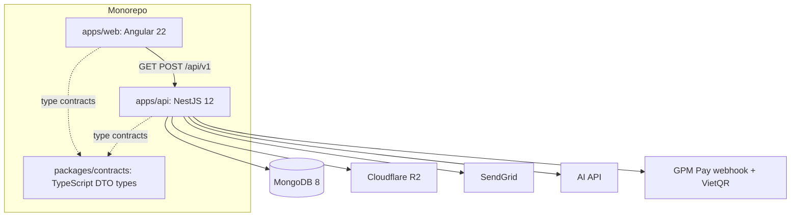

# Kiến trúc hệ thống

**ARCH-FASHION-001 · v1.0**

## 1. Mục tiêu và đặc tính kiến trúc

- Modular monolith để đơn giản hoá triển khai, quản lý nghiệp vụ theo boundary; không triển khai microservice khi chưa có nhu cầu thực tế.
- Frontend Angular standalone; API NestJS/TypeScript giữ business validation, authorization, giá/đơn, quản lý tích hợp.
- MongoDB lưu sự kiện nghiệp vụ/trạng thái; R2 lưu ảnh theo object key; SendGrid chỉ phát email, không là nguồn trạng thái nghiệp vụ chính.
- Hệ thống thanh toán và AI là bên ngoài; mọi kết quả cần được xác thực; độc lập trạng thái thất bại so với dữ liệu hệ thống.

## 2. Sơ đồ bối cảnh (C4 level 1)

## 3. Sơ đồ container (C4 level 2)

## 4. Logical modules

| Boundary | API NestJS | Angular feature | Các UC |
|---|---|---|---|
| Identity | auth, users, staff-permissions | account, admin/accounts | UC01–UC06, UC30 |
| Catalog/Lookbook | products, categories, lookbooks | catalog, product detail, lookbook | UC07–UC11 |
| AI Experiences | ai-jobs, quota, media | try-on, mix-match | UC12–UC13 |
| Commerce | cart, checkout, orders, shipments, stock, vouchers | cart, checkout, order history | UC14–UC21 |
| Community | reviews, posts, comments, moderation | community, reviews | UC22–UC25 |
| Payment | VietQR payment/refund, GPM Pay webhook/reconciliation tiền vào/ra, manual bank transfer refunds | payments, QR/polling, admin review/refunds | UC26–UC29 |
| Reporting/Config | admin, reports, settings, audit | admin/dashboard | UC31–UC32 |
| Email/Notification | mail, email-events, notifications | notification center | UC33–UC37 |

Trạng thái code của từng boundary chỉ được theo dõi tại [Implementation Status](12-IMPLEMENTATION-STATUS.md).

## 5. Request flow

1. Angular hiển thị; bảo vệ route frontend là UX, không có giá trị cấp quyền.
2. API `ValidationPipe` kiểm tra DTO, `AuthGuard` kiểm JWT/role/trạng thái user, service kiểm ownership và invariants nghiệp vụ.
3. Service áp dụng cập nhật nguyên tử/transaction cho kho, đơn, voucher và thanh toán.
4. Domain event ghi outbox/event-log bền vững; worker riêng sẽ gửi email/notification, bảo đảm retry và idempotency.
5. Backend dựng VietQR từ Order snapshot. Webhook GPM Pay được xác minh HMAC trên raw body trước khi đối soát; màn hình chỉ polling/read API và không suy ra thành công từ việc hiển thị hoặc quét QR.

## 6. Xử lý đồng thời và lỗi

| Luồng | Cơ chế |
|---|---|
| Checkout | Idempotency key + unique index; atomic reserved inventory theo SKU; transaction MongoDB replica set |
| GPM Pay webhook | HMAC `t.raw_body`, timestamp ≤300s; ignore `test`; allowlisted account + `in` + exact code/amount; unique `payload.id`; production chỉ nhận `REAL` |
| Refund | GPM Pay không có API ra lệnh refund; max refundable = paid - sum succeeded/pending refunds; maker/checker; QR hướng tới người nhận; webhook out chỉ auto-match khi đủ mã/tiền/nguồn/tài khoản đối ứng, còn lại review sao kê; dedup event/request |
| SendGrid | Event id → email event row → tối đa 5 lần theo DEC-11 → sent/failed; không ghi log token liên kết |
| AI | Job id + quota reservation; 5 job/ngày UTC; timeout/callback/poll; input 24 giờ, output 7 ngày; ảnh private |
| Media | Presigned URL ≤5 phút; verify nội dung thực bằng HEAD/scan, ownership & type; private image signed reads |

## 7. Phân vùng cấu trúc code

`apps/api/src/modules/<feature>` chứa controller, dto, service, schema, test. Không gọi trực tiếp schema của module khác từ controller; dùng service exported hoặc domain port. `packages/contracts` chỉ chứa type/constant không chứa bí mật hoặc quy tắc backend phụ thuộc database. Angular `pages` chứa compositional component, API services xử lý HTTP.

## 8. Chiến lược mở rộng

- Tách worker email/AI/notifications khi lưu lượng lớn, sử dụng outbox/queue và metrics nhưng không làm mất tính đúng đắn.
- Thêm CDN cho ảnh public R2; signed URL ảnh riêng, quyền truy cập trước khi ký.
- Chỉ cân nhắc cache sản phẩm sau khi có invalidation và số đo bottleneck.

## 9. Ràng buộc đặc tả

- Không gửi `SENDGRID_API_KEY` hay R2 secret cho client.
- Không dùng `R2_PUBLIC_BASE_URL` cho ảnh nhạy cảm.
- Không lưu thông tin thẻ, ảnh AI tự công khai, hay log access token.
- Phân quyền kết hợp role + permission + object ownership.

## 10. Tham chiếu

- [Data model](03-DATA-MODEL.md), [OpenAPI](openapi.yaml), [Migration](21-DATABASE-MIGRATIONS.md), [Event](22-EVENT-CONTRACTS.md), [Storage R2](14-STORAGE-R2.md), [SendGrid](13-EMAIL-SENDGRID.md), [Security](09-SECURITY.md), [Runbook](24-OPERATIONS-RUNBOOK.md).
