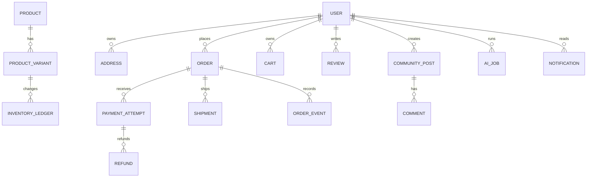

# Mô hình dữ liệu và MongoDB schema

**DATA-FASHION-001 · v1.0** · Các collection dưới đây định nghĩa **data model mục tiêu**. Backend đã có schema/index scaffold cho các collection; `users`, `addresses` và `products` có luồng nghiệp vụ ở mức cơ bản. Schema scaffold không thay thế migration, transaction, authorization hoặc acceptance test.

## 1. Domain entities

| Collection | Primary keys/fields | Index/Ràng buộc | Thuộc module |
|---|---|---|---|
| `users` | `_id`, `email`, `passwordHash`, `role`, `status`, `emailVerifiedAt` | unique lowercase email; không lộ hash | identity |
| `staff_permissions` | `staffId`, `permission`, `scope`, `grantedBy` | unique staffId + permission + scope | admin |
| `auth_sessions` | `userId`, `refreshHash`, `expiresAt`, `revokedAt` | TTL expiry; lưu hash token | identity |
| `email_tokens` | `userId`, `purpose`, `tokenHash`, `expiresAt`, `usedAt` | unique hash, TTL; never plain | identity |
| `addresses` | `customerId`, `receiver`, `phone`, `location`, `isDefault` | partial unique customerId where default | identity |
| `categories` | `slug`, `name`, `parentId`, `status` | unique slug; forbid cycles | catalog |
| `products` | `slug`, `name`, `description`, `status`, `mediaKeys` | unique slug, text/name index | catalog |
| `product_variants` | `productId`, `sku`, `size`, `color`, `price`, `stockOnHand`, `reserved` | unique SKU; nonnegative, available=onHand-reserved | catalog/stock |
| `lookbooks` | `title`, `mediaKeys`, `tags[]`, `status` | product refs exist on publish | catalog |
| `carts` | `customerId`, `items[{variantId,qty}]` | unique customer; one line/variant | commerce |
| `orders` | `code`, `customerId`, `items(snapshot)`, `money`, `shippingSnapshot`, `state`, `paymentDueAt`, `idempotencyKey` | unique code, unique customer+idempotencyKey; state+paymentDueAt | commerce |
| `order_events` | `orderId`, `from`, `to`, `actorId`, `createdAt`, `reason` | append-only | commerce |
| `inventory_ledger` | `variantId`, `orderId`, `quantity`, `type`, `eventKey` | unique eventKey | inventory |
| `vouchers` | `code`, `rules`, `validFrom/To`, `limit`, `usedCount` | unique normalized code; atomic usage | promotion |
| `shipments` | `orderId`, `carrier`, `trackingCode`, `status`, `events[]` | one active shipment/order | commerce |
| `payment_attempts` | `orderId`, `provider=GPMPAY\|SEPAY`, `reconciliationCode`, `expectedAmount`, `currency`, `state`, `expiresAt`, `matchedEventId` | unique provider+reconciliationCode; partial unique orderId khi state=SUCCEEDED | payment |
| `payment_events` | `provider=GPMPAY\|SEPAY`, `eventId`, `gateway`, `accountNumberHash/last4`, `counterAccountHash/last4`, `counterBankBin`, `transferType`, `transferAmount`, `referenceCode`, `source`, `signatureVerified`, `authenticationMethod`, `payloadDigest`, `resolution`, `matchedRefundId` | unique provider+eventId; một event tiền ra chỉ gắn một refund | payment |
| `refunds` | `paymentAttemptId`, `amount`, `state`, `idempotencyKey`, `reason`, `proposedBy`, `approvedBy`, recipient snapshot mã hóa (bank BIN, account, name), `reconciliationCode`, `approvedAt`, `matchedEventId`, `bankReference`, `refundedAt`, `evidenceKey`, `confirmedBy` | unique idempotencyKey/reconciliationCode/matchedEventId; non-failed+succeeded allocation <= paid | payment |
| `reviews` | `orderItemId`, `customerId`, `stars`, `content`, `status` | unique orderItemId+customer | community |
| `community_posts` | `authorId`, `caption`, `mediaKeys`, `status` | indexed status+createdAt | community |
| `comments` | `postId`, `authorId`, `parentId`, `status`, `body` | postId+createdAt | community |
| `moderation_logs` | `targetType`, `targetId`, `action`, `actorId`, `reason` | audit append-only | community |
| `ai_jobs` | `ownerId`, `type`, `inputKeys`, `outputKeys`, `state`, `expiresAt`, `quotaEventKey` | owner+createdAt; TTL lifecycle | ai |
| `ai_quotas` | `ownerId`, `windowStart`, `type`, `used` | unique owner+type+window | ai |
| `media_objects` | `key`, `ownerId`, `purpose`, `visibility`, `status`, `expiresAt` | unique key; cleanup state | storage |
| `email_events` | `dedupKey`, `to`, `template`, `state`, `attempts`, `providerId` | unique dedupKey | mail |
| `notifications` | `ownerId`, `type`, `reference`, `readAt`, `createdAt` | ownerId+createdAt | notifications |
| `system_settings` | `key`, `value`, `updatedBy`, `version` | unique key | config |
| `audit_logs` | `actorId`, `action`, `entityType`, `entityId`, `metadata` | time-indexed append-only | operations |
| `outbox_events` | envelope event, `status`, `attempts`, `nextAttemptAt`, lease | unique eventId; status+nextAttemptAt | operations |

## 2. ER diagram dạng khái niệm

## 3. Money & snapshots

Đơn vị tiền VND dùng integer (đồng), không lưu float làm tiền thanh toán. Order snapshot bắt buộc: `productId`, `variantId`, `sku`, `productName`, `unitPrice`, `quantity`, `discount`, `lineTotal`, `subtotal`, `shippingFee`, `voucherDiscount`, `payableTotal`, địa chỉ và thông tin người nhận. Số tiền tạo giao dịch phải tính tại server và đối chiếu tuyệt đối với provider.

## 4. Đồng thời/transaction

- `stockOnHand >= reserved >= 0`; reserve bằng atomic conditional update khi `stockOnHand - reserved >= qty`.
- Transaction MongoDB để tạo order, reserve nhiều SKU, giữ lượt voucher. Mongo replica set hoặc MongoDB Atlas bắt buộc cho multi-document transactions; compose dev mặc định **chỉ phù hợp API hiện có**, trước khi làm checkout phải nâng dev compose lên replica set và test failover.
- Order giữ kho 30 phút từ lúc tạo; worker hết hạn chạy tối đa mỗi phút. Hết hạn/hủy chỉ release một lần qua unique `eventKey`; webhook muộn vào review, không khôi phục Order.
- Xử lý webhook GPM Pay và SePay phải `idempotent` theo `(provider,eventId)`; chỉ một giao dịch `in` đúng toàn bộ `expectedAmount` và mã đối soát của attempt cùng provider mới tự động thành công. `SIMULATED` GPM Pay không được ghi nhận ở production; SePay Test Mode phải dùng cấu hình tách biệt.

## 5. Quyền dữ liệu / lifecycle

- Customer luôn truy vấn lọc `ownerId/customerId` lấy từ JWT server, không tin ID truyền từ request.
- Product/Lookbook đã publish dùng URL public; ảnh cá nhân AI và nội dung chưa duyệt dùng private bucket/presigned GET sau kiểm quyền.
- TTL index chỉ xóa record MongoDB; muốn xóa object R2 phải có lifecycle/cleanup worker riêng.
- Dữ liệu đơn/payment/audit không được cascade delete khi tài khoản bị khóa.

## 6. Migrations / indexes / seed

Quy trình, index canonical, thứ tự wave, seed và rollback được định nghĩa tại [Kế hoạch migration](21-DATABASE-MIGRATIONS.md). Seed không bao gồm PII/secret; bootstrap Admin là command riêng. Backup mã hóa và restore rehearsal theo [Operations Runbook](24-OPERATIONS-RUNBOOK.md).
