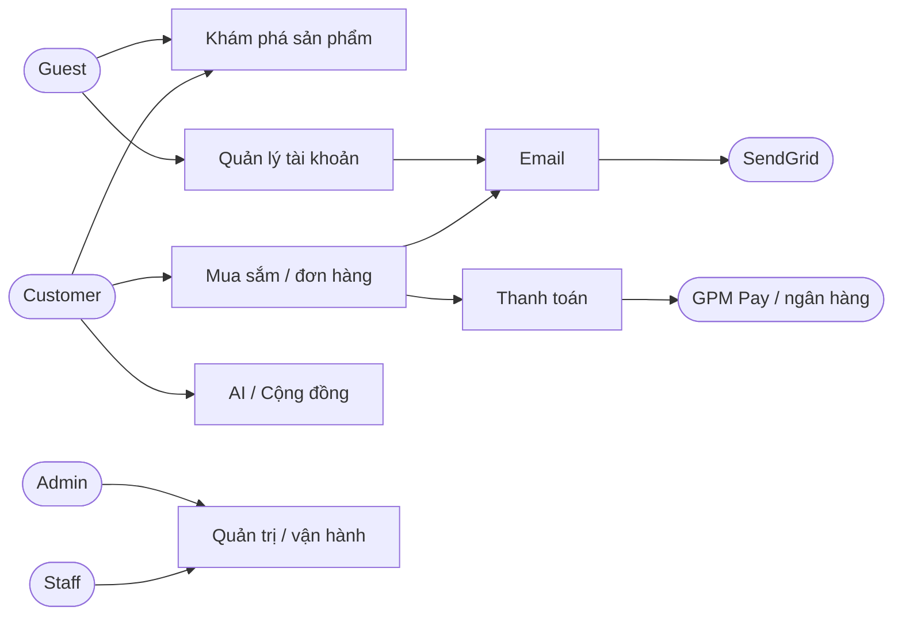

# 10 USE CASE TỔNG QUÁT

**Mục đích:** cung cấp góc nhìn nghiệp vụ để thảo luận phạm vi và dựng Use Case Diagram mức hệ thống. 37 UC chi tiết là đơn vị thiết kế, lập trình và QA.

| Mã | Tên nhóm nghiệp vụ | Use Case thành phần |
|---|---|---|
| UC-T01 | Quản lý tài khoản người dùng | UC01, UC02, UC03, UC04, UC05, UC06 |
| UC-T02 | Khám phá sản phẩm và Lookbook | UC07, UC08, UC10 |
| UC-T03 | Quản lý sản phẩm và Lookbook | UC09, UC11 |
| UC-T04 | Trải nghiệm thời trang với AI | UC12, UC13 |
| UC-T05 | Mua sắm và quản lý đơn hàng | UC14, UC15, UC16, UC17 |
| UC-T06 | Quản lý vận hành bán hàng | UC18, UC19, UC20, UC21 |
| UC-T07 | Quản lý cộng đồng thời trang | UC22, UC23, UC24, UC25 |
| UC-T08 | Quản lý thanh toán và hoàn tiền | UC26, UC27, UC28, UC29 |
| UC-T09 | Quản trị và giám sát hệ thống | UC30, UC31, UC32 |
| UC-T10 | Email và thông báo | UC33, UC34, UC35, UC36, UC37 |

## Hướng dẫn dùng sơ đồ

Tác nhân con người: Guest, Customer, Admin, Staff. Tác nhân ngoài: GPM Pay (webhook biến động số dư), Dịch vụ AI, SendGrid. Các hoạt động tự động (email, webhook, notifications) thể hiện quan hệ với Use Case nghiệp vụ; không gán thành role đăng nhập.

