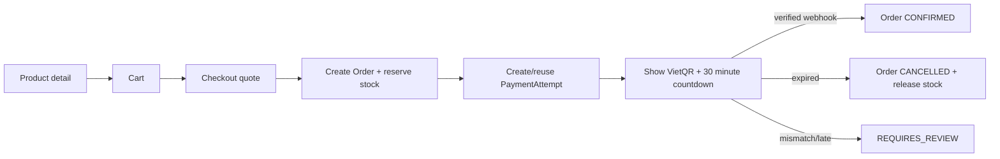

# UI flow và trạng thái màn hình

**UI-FASHION-001 · v1.0 · 24/10/2026**

Tài liệu này là nguồn chuẩn cho cấu trúc màn hình và trạng thái giao diện. Quy tắc nghiệp vụ vẫn thuộc [SRS](01-SRS.md), quyền thuộc [RBAC](04-RBAC.md), API thuộc [OpenAPI](openapi.yaml). Không suy diễn quyền hoặc trạng thái thành công từ UI.

## 1. Khung điều hướng

| Khu vực | Route web | Actor | Màn hình chính |
|---|---|---|---|
| Storefront | `/`, `/products`, `/products/:slug`, `/lookbooks`, `/community` | Public | khám phá, tìm/lọc, chi tiết |
| Account | `/account/*` | Customer/Staff/Admin | hồ sơ, địa chỉ, đổi mật khẩu, thông báo |
| Commerce | `/cart`, `/checkout`, `/orders`, `/orders/:id`, `/payment/:attemptId` | Customer | giỏ, quote, đặt hàng, QR, lịch sử |
| Experiences | `/ai/try-on`, `/ai/mix-match`, `/community/me` | Customer | job AI và nội dung cá nhân |
| Operations | `/admin/*` | Admin/Staff theo permission | catalog, đơn, kho, moderation, payment |
| Administration | `/admin/users`, `/admin/vouchers`, `/admin/reports`, `/admin/settings` | Admin | user/quyền, voucher, báo cáo, cấu hình |

Route guard phía Angular chỉ hỗ trợ trải nghiệm; backend vẫn kiểm tra role, permission, scope và ownership cho mọi request.

## 2. Trạng thái bắt buộc dùng chung

Mỗi màn hình dữ liệu phải có `initial`, `loading`, `success`, `empty`, `validation-error`, `request-error`, `forbidden` và `offline/retry` nếu có request. Mutation khóa nút trong lúc gửi và chống double-submit; thông báo thành công chỉ xuất hiện sau response thành công. `401` chuyển tới login và giữ `returnUrl` nội bộ; `403` hiển thị từ chối; `404` không tiết lộ tài nguyên riêng có tồn tại.

Form hiển thị lỗi cạnh field, summary lỗi ở đầu form và đưa focus tới lỗi đầu tiên. Modal phải trap focus, đóng bằng Escape khi an toàn và trả focus về trigger. Không dùng màu làm tín hiệu duy nhất.

## 3. Flow xác thực

1. Register → thông báo kiểm tra email, không tự đăng nhập.
2. Verify email → success → login; token sai/hết hạn → trạng thái lỗi và nút resend có throttle.
3. Login → nhận access/refresh session → quay lại `returnUrl` nội bộ.
4. Refresh diễn ra một lần khi access hết hạn; refresh lỗi/replay → xóa local session và login lại.
5. Forgot luôn hiển thị cùng một kết quả bất kể email tồn tại; reset thành công thu hồi mọi session.
6. Logout thu hồi session hiện tại trước khi xóa state phía client; nếu mạng lỗi vẫn xóa local token và không coi server đã revoke cho tới khi session hết hạn.

## 4. Flow mua hàng và thanh toán

- Cart luôn ghi “giá/tồn sẽ được xác nhận khi đặt hàng”. Checkout hiển thị subtotal, voucher, shipping, payable total và quote expiry.
- Khi tạo Order, FE gửi `Idempotency-Key`; retry dùng lại cùng key và cùng body.
- Màn QR hiển thị số tiền, ngân hàng, số tài khoản che bớt, nội dung chuyển khoản, thời gian còn lại; copy từng trường; không tuyên bố “đã thanh toán” khi chỉ quét QR.
- Poll attempt với backoff 3 giây → 5 giây → 10 giây, dừng khi terminal/ẩn tab; khi quay lại phải fetch lại server state.
- `SUCCEEDED`: chuyển Order detail và hiển thị mã đơn. `FAILED/expired`: không tiếp tục dùng QR cũ; Order đã hết hạn không tạo attempt mới. `REQUIRES_REVIEW`: hiển thị đã nhận thông tin và đang đối soát, không hứa thời gian hoàn thành.
- Customer chỉ thấy nút hủy ở `PENDING_PAYMENT`. Hủy đơn đã trả tiền chỉ do vận hành xử lý theo DEC-03.

## 5. Flow vận hành

| Màn hình | Dữ liệu/tác vụ | Guard UI bổ sung |
|---|---|---|
| Order queue | lọc state, assigned staff, payment state | chỉ hiện action hợp lệ từ state hiện tại |
| Order detail | snapshot, history, shipment, payment | ghi reason bắt buộc; confirm action không đảo ngược |
| Refund queue | proposal → bổ sung/kiểm tra tài khoản nhận → approve → QR chuyển khoản → chờ webhook đối soát → complete/review/fail | proposer không thấy nút approve; QR hiện ngân hàng/tài khoản Customer, số tiền, mã nội dung; QR không đổi state; complete thủ công chỉ sau đối chiếu sao kê với bankReference + evidence |
| Payment review | unmatched/mismatch/late event | không có thao tác “đánh dấu paid” bỏ qua audit/transaction |
| Inventory | available/on-hand/reserved, ledger | adjustment bắt buộc reason và version |
| Staff permissions | permission + scope | Admin only; cảnh báo khi thu quyền đang dùng |

### 5.1 Chat hỗ trợ khách hàng

- **Khách (`/support`):** hai cột (danh sách phiếu | hội thoại), một cột trên mobile. Tạo yêu cầu bằng hộp thoại (loại, tiêu đề 5–150 ký tự, đơn liên quan tùy chọn, nội dung ≤ 2000). `/orders/:id` có nút "Gửi yêu cầu hỗ trợ" → `/support?orderId=` tự mở hộp thoại với loại Đơn hàng. Thông báo "Hỗ trợ" mở `/support?ticketId=`.
- **Nhân sự (`/admin/support`, quyền `order.read`):** tab Cần xử lý / Tất cả / Đã đóng, tìm kiếm qua API (chờ 300 ms), bộ lọc Của tôi / Chưa phân công / loại phiếu; hội thoại chia theo ngày; drawer thông tin khách và đơn với các nút Tiếp nhận (Admin hoặc GLOBAL), Phân công (chỉ Admin), Đã giải quyết, Đóng phiếu (có xác nhận). Mục menu "Khách hàng & Hỗ trợ" có số phiếu chưa đọc.
- **Vòng đời:** `OPEN` → nhân sự trả lời hoặc nhận phiếu → `IN_PROGRESS` → `RESOLVED` → khách nhắn tiếp thì mở lại (`IN_PROGRESS` nếu đã có người phụ trách, ngược lại `OPEN`) → `CLOSED` (khách hoặc nhân sự đóng; không nhắn thêm được, khách tạo yêu cầu mới).
- **Cập nhật gần thời gian thực bằng polling:** tin nhắn của phiếu đang mở mỗi 5 giây (`messages?after=`), danh sách khách 30 giây, danh sách nhân sự 15 giây, số chưa đọc trên menu 30 giây. Chỉ chạy khi `document.visibilityState === 'visible'` và dừng khi rời trang. Không dùng WebSocket.
- **Giới hạn bản này:** chưa có tệp đính kèm; nội dung là chữ thuần (hiển thị bằng nội suy, không HTML); khách tối đa 20 tin/phút và 5 phiếu/giờ (429 kèm thông báo tiếng Việt); danh sách tải tối đa 50 phiếu mới nhất, tìm kiếm để thu hẹp; lọc theo loại phiếu của nhân sự làm ở trình duyệt.

## 6. Flow AI và media

- Trước upload phải hiển thị consent riêng cho mục đích AI, thời gian giữ input/output và nút xóa.
- Upload: presign → PUT → finalize → tạo job. Không cho tạo job bằng object chưa finalize.
- Nếu bật fashion planner: nhận diện người/vùng nhìn thấy + từng sản phẩm → kiểm tra điều kiện → lập phương án phối/layer → tạo prompt theo loại hàng → renderer. UI hiển thị phase, loại sản phẩm đã nhận diện và tóm tắt phương án. Lỗi thiếu chân/mặt, không có người hoặc sản phẩm không rõ phải hướng dẫn chọn lại ảnh; không tự tạo thêm vùng cơ thể để vượt kiểm tra.
- Job hiển thị `PENDING`, `PROCESSING`, `COMPLETED`, `FAILED`, `EXPIRED`; polling 5–15 giây. Lỗi provider nêu trạng thái và việc hoàn quota, không lộ provider payload.
- Ảnh private lấy signed GET sau khi kiểm owner; UI không lưu URL ký dài hơn phiên hiển thị.

## 7. Responsive và accessibility acceptance

- Breakpoint mục tiêu: mobile `<768px`, tablet `768–1023px`, desktop `>=1024px`; chức năng không bị mất giữa breakpoint.
- Checkout và payment ưu tiên một cột trên mobile; QR không vượt viewport; bảng admin chuyển thành card hoặc scroll có label.
- Đạt WCAG 2.2 AA cho contrast, keyboard, focus visible, label/name/role, thông báo lỗi và reduced motion.
- Các trang quan trọng được test ở 360×800, 768×1024, 1440×900; Chrome/Edge phiên bản hiện hành và Safari mobile gần nhất.

## 8. Evidence bàn giao

Mỗi flow phải có ảnh hoặc video cho success, empty, validation error, server error và forbidden; link evidence vào testcase tương ứng. Thiết kế hình ảnh có thể thay đổi nhưng không được bỏ state hoặc policy trong tài liệu này.
